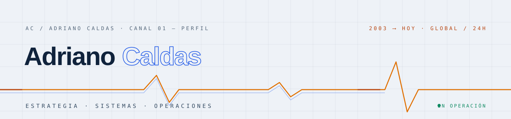

<div align="center">

<picture>
  <source media="(prefers-color-scheme: dark)" srcset="https://raw.githubusercontent.com/adrianocmcaldas/adrianocmcaldas/main/assets/banner-dark-es.svg">
  
</picture>

[PT](https://github.com/adrianocmcaldas/adrianocmcaldas/blob/main/README.pt.md) · [EN](https://github.com/adrianocmcaldas/adrianocmcaldas/blob/main/README.md) · **ES** · [NO](https://github.com/adrianocmcaldas/adrianocmcaldas/blob/main/README.no.md)

# Adriano César Moreno Caldas

*Tecnología de extremo a extremo: de la decisión al sistema en producción,<br>del algoritmo a la operación global.*

[](https://adrianocaldas.com/?lang=es)
[](https://adrianocaldas.com/?lang=es#contato)
[](https://adrianocaldas.com/?lang=es)

</div>

---

Trabajo entre la **dirección tecnológica**, la **creación de productos** y la **operación de entornos complejos**. He desempeñado funciones de CTO en organizaciones multinacionales y dirijo iniciativas propias y de terceros en distintos países. Desde **2003** trabajo con procesamiento digital de señales, algoritmos de IA y entrenamiento de modelos — una base que evolucionó hacia software, telecomunicaciones, cloud, redes, automatización y electrónica aplicada.

## `»` Más reciente · Agentic AI Factory

[**NordixBIOS**](https://nordixbios.com) es mi proyecto más reciente: una **Agentic AI Factory** — se conecta a tu software (ERP, CRM, TPV o SaaS vertical) y pone la infraestructura completa para crear y operar **trabajadores IA** en todas las capas, con tu marca.

## `»` Actividad

<div align="center">

[](https://adrianocaldas.com/?lang=es#dir)
[](https://adrianocaldas.com/?lang=es#sft)
[](https://adrianocaldas.com/?lang=es#aim)
[](https://adrianocaldas.com/?lang=es#cld)<br>
[](https://adrianocaldas.com/?lang=es#dat)
[](https://adrianocaldas.com/?lang=es#sec)
[](https://adrianocaldas.com/?lang=es#aut)
[](https://adrianocaldas.com/?lang=es#dig)

</div>

| Canal | Foco | Temas |
|---|---|---|
| `DIR` | Estrategia y dirección tecnológica | CTO · TI · producto · programas · proveedores · ITSM |
| `SFT` | Software y productos digitales | frontend · backend · APIs · QA · escritorio · móvil |
| `AIM` | IA, señales y modelos | DSP · ML · deep learning · LLMs · agentes · RAG · MLOps · GPU |
| `CLD` | Cloud, redes y operaciones | AWS · Azure · Google Cloud · Kubernetes · IaC · DevOps · SRE |
| `DAT` | Datos, integraciones y plataformas | SQL · NoSQL · ETL/ELT · streaming · gobierno de datos · analytics |
| `SEC` | Seguridad y resiliencia | IAM · Zero Trust · vulnerabilidades · DR · continuidad · compliance |
| `AUT` | Automatización y sistemas físicos | firmware · PCB · IoT · edge · OT · SCADA/HMI · control |
| `DIG` | Presencia y crecimiento digital | medios · adquisición pagada · SEO técnico · GEO · LLMO · reputación |

## `»` Ecosistema

| Producto propio | Foco | Dominio |
|---|---|---|
| **NordixBIOS** | **Agentic AI Factory** — trabajadores IA para tu software | [nordixbios.com](https://nordixbios.com) |
| **NordixAIgency** | Agentes de IA que ejecutan acciones reales en software propio y de terceros | [nordixaigency.com](https://nordixaigency.com) |
| **Cinteca** | Marca tecnológica de AD Caldas Innotec, S.A. | [cinteca.es](https://cinteca.es) |
| **LegalNeuron** | IA y software para el sector jurídico | [legalneuron.es](https://legalneuron.es) |
| **NCS Engine** | Infraestructura para cargas de IA | [ncsengine.com](https://ncsengine.com) |
| **Nordix Systems** | Sistemas y soluciones digitales | [nordixsystems.com](https://nordixsystems.com) |
| **CINTE** | Telecomunicaciones y tecnología, desde 2004 | [cinte.com.br](https://cinte.com.br) |

**Colaboraciones seleccionadas** — [Plorea 🇳🇴](https://plorea.no) comercio unificado · [Grupo Laeras](https://grupolaeras.com) plataformas digitales · [Innocards Loyalty 🇨🇭](https://innocardloyalty.ch) fidelización

**Participaciones societarias** — [AI Robotics 🇳🇴](https://airobotics.no) robots de servicio autónomos para empresas en Noruega

## `»` Patentes

Siete solicitudes de patente en dos países — de la electrónica embebida a las redes neuronales.

| Número | Invención | Oficina · estado |
|---|---|---|
| `P202631350` | Computación condicional con reservorio de neuronas direccionables y selección de cardinalidad exacta | 🇪🇸 OEPM · presentada en 2026 · en tramitación |
| `P202631351` | Reparto de un presupuesto de cómputo por elemento entre capas de una red neuronal | 🇪🇸 OEPM · presentada en 2026 · en tramitación |
| `P202631352` | Ampliación de un reservorio de unidades direccionables que preserva la función calculada | 🇪🇸 OEPM · presentada en 2026 · en tramitación |
| `P202631353` | Rescate por división de unidades infrautilizadas en un reservorio de unidades direccionables | 🇪🇸 OEPM · presentada en 2026 · en tramitación |
| `PI 0600924-7` | Conmutador de combustible para automóviles bi o tricombustible con medición digital del volumen de GNV | 🇧🇷 INPI · presentada en 2006 · publicada en 2007 |
| `PI 0706462-4` | Estetoscopio electrónico digital con almacenamiento, transmisión inalámbrica y sugerencia de diagnóstico | 🇧🇷 INPI · presentada en 2007 · publicada en 2009 |
| `PI 0801894-4` | Analizador de nivel y calidad de combustible en estaciones de servicio, con procesamiento remoto | 🇧🇷 INPI · presentada en 2008 · publicada en 2010 |

Solicitudes españolas presentadas por AD Caldas Innotec, S.A.; solicitudes brasileñas con Adriano como titular e inventor. Registro completo en [adrianocaldas.com](https://adrianocaldas.com/?lang=es#patentes).

## `»` Trayectoria

```text
      ┌─ 2003 ── Señales, algoritmos y modelos ──── DSP e IA aplicada
      │
──────╫── 2004 ── CINTE · Telecomunicaciones ────── inicio de la trayectoria empresarial
      │
      ╫── 2014 ── AD Caldas Innotec, S.A. ──────── sociedad española · NIF A66316399
      │
      └─ HOY ─── Ecosistema global ──────────────── software · IA · infraestructura · sistemas conectados
```

## `»` Vitrina

Los sitios de este perfil son código abierto — dos rediseños completos con tests de contenido, i18n en 4 idiomas y accesibilidad WCAG AA documentada:

[`adrianocaldas.com`](https://github.com/adrianocmcaldas/adrianocaldas.com) — identidad **«Señal»** (sala de control oscura) · [`cinteca.com`](https://github.com/adrianocmcaldas/cinteca.com) — identidad **«Registro»** (casa institucional)

---

<div align="center">
<sub><code>» señal continua desde 2003 · en operación</code> — sin cookies, sin analytics, ningún correo personal publicado</sub>
</div>
