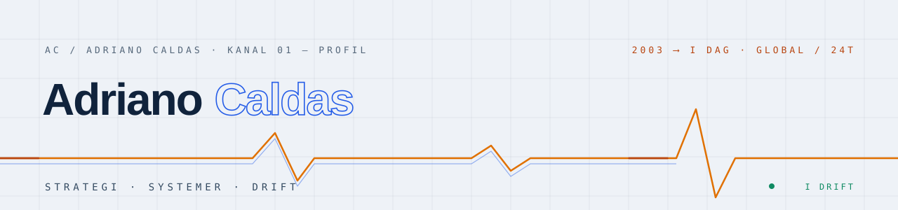

<div align="center">

<picture>
  <source media="(prefers-color-scheme: dark)" srcset="https://raw.githubusercontent.com/adrianocmcaldas/adrianocmcaldas/main/assets/banner-dark-no.svg">
  
</picture>

[PT](https://github.com/adrianocmcaldas/adrianocmcaldas/blob/main/README.pt.md) · [EN](https://github.com/adrianocmcaldas/adrianocmcaldas/blob/main/README.md) · [ES](https://github.com/adrianocmcaldas/adrianocmcaldas/blob/main/README.es.md) · **NO**

# Adriano César Moreno Caldas

*Teknologi fra ende til ende: fra beslutning til produksjon,<br>fra algoritme til global drift.*

[](https://adrianocaldas.com/?lang=nb)
[](https://adrianocaldas.com/?lang=nb#contato)
[](https://adrianocaldas.com/?lang=nb)

</div>

---

Jeg arbeider i skjæringspunktet mellom **teknologiledelse**, **produktutvikling** og **drift av komplekse miljøer**. Jeg har hatt CTO-roller i multinasjonale virksomheter og leder egne og eksterne initiativer i flere land. Siden **2003** har jeg arbeidet med digital signalbehandling, KI-algoritmer og trening av modeller — et grunnlag som har utviklet seg til programvare, telekommunikasjon, sky, nettverk, automatisering og anvendt elektronikk.

## `»` Nyeste · Agentic AI Factory

[**NordixBIOS**](https://nordixbios.com) er mitt nyeste prosjekt: en **Agentic AI Factory** — den kobles til programvaren din (ERP, CRM, kasse eller vertikal SaaS) og leverer full infrastruktur for å skape og drifte **KI-arbeidere** i alle lag, under din merkevare.

## `»` Kompetanse

<div align="center">

[](https://adrianocaldas.com/?lang=nb#dir)
[](https://adrianocaldas.com/?lang=nb#sft)
[](https://adrianocaldas.com/?lang=nb#aim)
[](https://adrianocaldas.com/?lang=nb#cld)<br>
[](https://adrianocaldas.com/?lang=nb#dat)
[](https://adrianocaldas.com/?lang=nb#sec)
[](https://adrianocaldas.com/?lang=nb#aut)
[](https://adrianocaldas.com/?lang=nb#dig)

</div>

| Kanal | Fokus | Temaer |
|---|---|---|
| `DIR` | Teknologistrategi og ledelse | CTO · IT · produkt · programmer · leverandører · ITSM |
| `SFT` | Programvare og digitale produkter | frontend · backend · API-er · QA · desktop · mobil |
| `AIM` | KI, signaler og modeller | DSP · ML · deep learning · LLM-er · agenter · RAG · MLOps · GPU |
| `CLD` | Sky, nettverk og drift | AWS · Azure · Google Cloud · Kubernetes · IaC · DevOps · SRE |
| `DAT` | Data, integrasjoner og plattformer | SQL · NoSQL · ETL/ELT · strømming · datastyring · analyse |
| `SEC` | Sikkerhet og robusthet | IAM · Zero Trust · sårbarheter · DR · kontinuitet · etterlevelse |
| `AUT` | Automatisering og fysiske systemer | firmware · PCB · IoT · edge · OT · SCADA/HMI · styring |
| `DIG` | Digital tilstedeværelse og vekst | medier · betalt synlighet · teknisk SEO · GEO · LLMO · omdømme |

## `»` Økosystem

| Eget produkt | Fokus | Domene |
|---|---|---|
| **NordixBIOS** | **Agentic AI Factory** — KI-arbeidere for programvaren din | [nordixbios.com](https://nordixbios.com) |
| **NordixAIgency** | KI-agenter som utfører reelle handlinger i egen og ekstern programvare | [nordixaigency.com](https://nordixaigency.com) |
| **Cinteca** | Teknologimerket til AD Caldas Innotec, S.A. | [cinteca.es](https://cinteca.es) |
| **LegalNeuron** | KI og programvare for juridisk sektor | [legalneuron.es](https://legalneuron.es) |
| **NCS Engine** | Infrastruktur for KI-arbeidslaster | [ncsengine.com](https://ncsengine.com) |
| **Nordix Systems** | Digitale systemer og løsninger | [nordixsystems.com](https://nordixsystems.com) |
| **CINTE** | Telekommunikasjon og teknologi, siden 2004 | [cinte.com.br](https://cinte.com.br) |

**Utvalgte samarbeid** — [Plorea 🇳🇴](https://plorea.no) samlet handel · [Grupo Laeras](https://grupolaeras.com) digitale plattformer · [Innocards Loyalty 🇨🇭](https://innocardloyalty.ch) lojalitet

**Eierandeler** — [AI Robotics 🇳🇴](https://airobotics.no) · medeier og CTO · autonome serviceroboter for norske virksomheter

## `»` Patenter

Sju patentsøknader i to land — fra innebygd elektronikk til nevrale nettverk.

| Nummer | Oppfinnelse | Kontor · status |
|---|---|---|
| `P202631350` | Betinget beregning med et reservoar av adresserbare nevroner og utvalg med eksakt kardinalitet | 🇪🇸 OEPM · levert 2026 · under behandling |
| `P202631351` | Fordeling av et beregningsbudsjett per element mellom lagene i et nevralt nettverk | 🇪🇸 OEPM · levert 2026 · under behandling |
| `P202631352` | Utvidelse av et reservoar av adresserbare enheter som bevarer den beregnede funksjonen | 🇪🇸 OEPM · levert 2026 · under behandling |
| `P202631353` | Redning av underutnyttede enheter ved deling i et reservoar av adresserbare enheter | 🇪🇸 OEPM · levert 2026 · under behandling |
| `PI 0600924-7` | Drivstoffvelger for biler med to eller tre drivstoff, med digital måling av CNG-volum | 🇧🇷 INPI · levert 2006 · publisert 2007 · henlagt 2012 |
| `PI 0706462-4` | Digitalt elektronisk stetoskop med datalagring, trådløs overføring og diagnoseforslag | 🇧🇷 INPI · levert 2007 · publisert 2009 · henlagt 2012 |
| `PI 0801894-4` | Analysator for nivå og kvalitet på drivstoff ved bensinstasjoner, med fjernbehandling | 🇧🇷 INPI · levert 2008 · publisert 2010 · henlagt 2012 |

De spanske søknadene er levert av AD Caldas Innotec, S.A.; de brasilianske har Adriano som innehaver og oppfinner. Fullt register på [adrianocaldas.com](https://adrianocaldas.com/?lang=nb#patentes).

## `»` Utvikling

```text
      ┌─ 2003 ── Signaler, algoritmer og modeller ─ DSP og anvendt KI
      │
──────╫── 2004 ── CINTE · Telekommunikasjon ─────── starten på forretningsreisen
      │
      ╫── 2014 ── AD Caldas Innotec, S.A. ──────── spansk selskap · skatte-ID A66316399
      │
      └─ I DAG ─ Globalt økosystem ─────────────── programvare · KI · infrastruktur · sammenkoblede systemer
```

## `»` Utstilling

Nettstedene bak denne profilen er åpen kildekode — to komplette redesign med innholdstester, i18n på 4 språk og dokumentert WCAG AA-tilgjengelighet:

[`adrianocaldas.com`](https://github.com/adrianocmcaldas/adrianocaldas.com) — **«Signal»**-identitet (mørkt kontrollrom) · [`cinteca.com`](https://github.com/adrianocmcaldas/cinteca.com) — **«Register»**-identitet (institusjonelt hus)

---

<div align="center">
<sub><code>» kontinuerlig signal siden 2003 · i drift</code> — ingen informasjonskapsler, ingen analyse, ingen personlig e-post publisert</sub>
</div>
