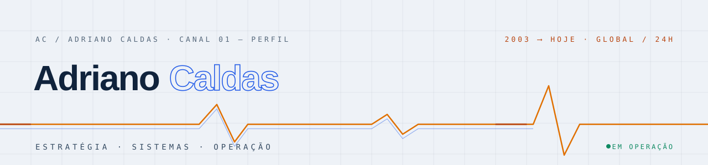

<div align="center">

<picture>
  <source media="(prefers-color-scheme: dark)" srcset="https://raw.githubusercontent.com/adrianocmcaldas/adrianocmcaldas/main/assets/banner-dark-pt.svg">
  
</picture>

**PT** · [EN](https://github.com/adrianocmcaldas/adrianocmcaldas/blob/main/README.md) · [ES](https://github.com/adrianocmcaldas/adrianocmcaldas/blob/main/README.es.md) · [NO](https://github.com/adrianocmcaldas/adrianocmcaldas/blob/main/README.no.md)

# Adriano César Moreno Caldas

*Tecnologia vista de ponta a ponta: da decisão ao sistema em produção,<br>do algoritmo à operação global.*

[](https://adrianocaldas.com)
[](https://adrianocaldas.com/#contato)
[](https://adrianocaldas.com)

</div>

---

Atuo entre **direção tecnológica**, **criação de produtos** e **operação de ambientes complexos**. Já exerci funções de CTO em organizações multinacionais e conduzo iniciativas próprias e de terceiros em diferentes países. Desde **2003** trabalho com processamento digital de sinais, algoritmos de IA e treinamento de modelos — base que evoluiu para software, telecomunicações, cloud, redes, automação e eletrônica aplicada.

## `»` Mais recente · Agentic AI Factory

O [**NordixBIOS**](https://nordixbios.com) é o meu projeto mais recente: uma **Agentic AI Factory** — liga-se ao seu software (ERP, CRM, TPV ou SaaS vertical) e fornece a infraestrutura completa para criar e operar **trabalhadores de IA** em todas as camadas, com a sua marca.

## `»` Atuação

<div align="center">

[](https://adrianocaldas.com/#dir)
[](https://adrianocaldas.com/#sft)
[](https://adrianocaldas.com/#aim)
[](https://adrianocaldas.com/#cld)<br>
[](https://adrianocaldas.com/#dat)
[](https://adrianocaldas.com/#sec)
[](https://adrianocaldas.com/#aut)
[](https://adrianocaldas.com/#dig)

</div>

| Canal | Foco | Temas |
|---|---|---|
| `DIR` | Estratégia e direção tecnológica | CTO · TI · produto · programas · fornecedores · ITSM |
| `SFT` | Software e produtos digitais | frontend · backend · APIs · QA · desktop · mobile |
| `AIM` | IA, sinais e modelos | DSP · ML · deep learning · LLMs · agentes · RAG · MLOps · GPU |
| `CLD` | Cloud, redes e operação | AWS · Azure · Google Cloud · Kubernetes · IaC · DevOps · SRE |
| `DAT` | Dados, integrações e plataformas | SQL · NoSQL · ETL/ELT · streaming · governança · analytics |
| `SEC` | Segurança e resiliência | IAM · Zero Trust · vulnerabilidades · DR · continuidade · compliance |
| `AUT` | Automação e sistemas físicos | firmware · PCB · IoT · edge · OT · SCADA/HMI · controle |
| `DIG` | Presença e crescimento digital | mídias · aquisição paga · SEO técnico · GEO · LLMO · reputação |

## `»` Ecossistema

| Produto próprio | Foco | Domínio |
|---|---|---|
| **NordixBIOS** | **Agentic AI Factory** — trabalhadores de IA para o seu software | [nordixbios.com](https://nordixbios.com) |
| **NordixAIgency** | Agentes de IA que executam ações reais em softwares próprios e de terceiros | [nordixaigency.com](https://nordixaigency.com) |
| **Cinteca** | Marca tecnológica da AD Caldas Innotec, S.A. | [cinteca.es](https://cinteca.es) |
| **LegalNeuron** | IA e software para o setor jurídico | [legalneuron.es](https://legalneuron.es) |
| **NCS Engine** | Infraestrutura para cargas de IA | [ncsengine.com](https://ncsengine.com) |
| **Nordix Systems** | Sistemas e soluções digitais | [nordixsystems.com](https://nordixsystems.com) |
| **CINTE** | Telecomunicações e tecnologia, desde 2004 | [cinte.com.br](https://cinte.com.br) |

**Colaborações selecionadas** — [Plorea 🇳🇴](https://plorea.no) unified commerce · [Grupo Laeras](https://grupolaeras.com) plataformas digitais · [Innocards Loyalty 🇨🇭](https://innocardloyalty.ch) fidelização

**Participações societárias** — [AI Robotics 🇳🇴](https://airobotics.no) · sócio e CTO · robôs de serviço autônomos para empresas na Noruega

## `»` Patentes

Sete pedidos de patente em dois países — da eletrônica embarcada às redes neurais.

| Número | Invenção | Escritório · situação |
|---|---|---|
| `P202631350` | Computação condicional com reservatório de neurônios endereçáveis e seleção de cardinalidade exata | 🇪🇸 OEPM · apresentado em 2026 · em tramitação |
| `P202631351` | Distribuição de um orçamento de computação por elemento entre camadas de uma rede neural | 🇪🇸 OEPM · apresentado em 2026 · em tramitação |
| `P202631352` | Ampliação de um reservatório de unidades endereçáveis que preserva a função calculada | 🇪🇸 OEPM · apresentado em 2026 · em tramitação |
| `P202631353` | Resgate por divisão de unidades subutilizadas em um reservatório de unidades endereçáveis | 🇪🇸 OEPM · apresentado em 2026 · em tramitação |
| `PI 0600924-7` | Chave comutadora para automóveis bi ou tricombustível com medição digital do volume de GNV | 🇧🇷 INPI · depósito 2006 · publicado 2007 · arquivado 2012 |
| `PI 0706462-4` | Estetoscópio eletrônico digital com armazenamento, transmissão sem fio e sugestão de diagnóstico | 🇧🇷 INPI · depósito 2007 · publicado 2009 · arquivado 2012 |
| `PI 0801894-4` | Analisador de nível e qualidade de combustível em postos, com processamento remoto | 🇧🇷 INPI · depósito 2008 · publicado 2010 · arquivado 2012 |

Pedidos espanhóis apresentados pela AD Caldas Innotec, S.A.; pedidos brasileiros com Adriano como titular e inventor. Registro completo em [adrianocaldas.com](https://adrianocaldas.com/?lang=pt#patentes).

## `»` Trajetória

```text
      ┌─ 2003 ── Sinais, algoritmos e modelos ──── DSP e IA aplicada
      │
──────╫── 2004 ── CINTE · Telecomunicações ─────── início da trajetória empresarial
      │
      ╫── 2014 ── AD Caldas Innotec, S.A. ──────── estrutura espanhola · NIF A66316399
      │
      └─ HOJE ── Ecossistema global ────────────── software · IA · infraestrutura · sistemas conectados
```

## `»` Vitrine

Os sites deste perfil são código aberto — dois redesigns completos com testes de conteúdo, i18n em 4 línguas e acessibilidade WCAG AA documentada:

[`adrianocaldas.com`](https://github.com/adrianocmcaldas/adrianocaldas.com) — identidade **«Sinal»** (sala de controlo escura) · [`cinteca.com`](https://github.com/adrianocmcaldas/cinteca.com) — identidade **«Registo»** (casa institucional)

---

<div align="center">
<sub><code>» sinal contínuo desde 2003 · em operação</code> — sem cookies, sem analytics, nenhum e-mail pessoal publicado</sub>
</div>
